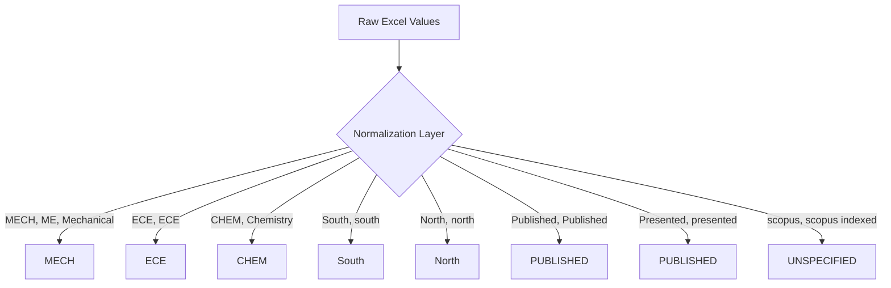
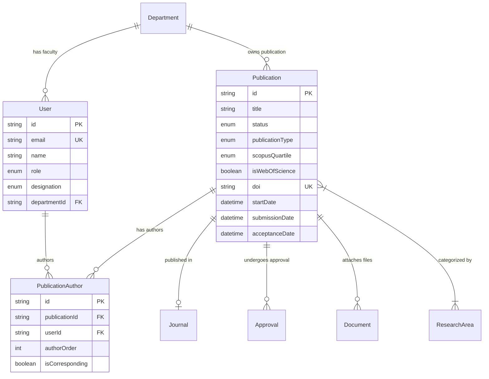
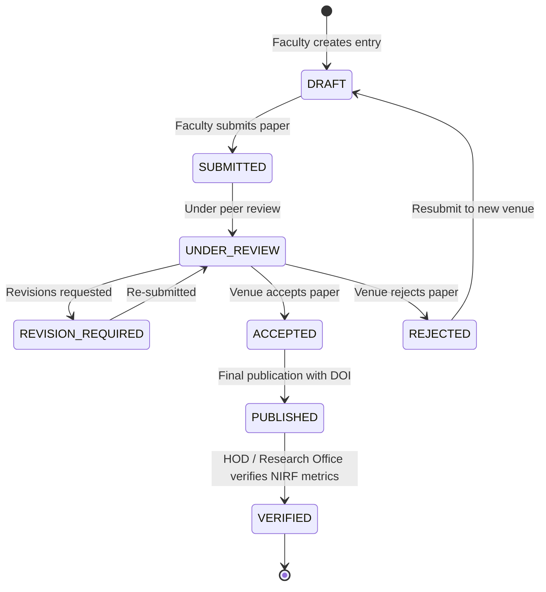

# NIE Research Publication Tracker — Legacy Data Analysis & System Architecture Plan

> [!IMPORTANT]
> **Phase 0 Deliverable**: This document presents a deep-dive analysis of the legacy Excel workbook (`NIE_Publication_Tracker_Enhanced.xlsx`), empirical findings across all 4 worksheets, clean data normalization rules, database field mappings, migration risk assessments, proposed application workflows, and a production-ready **Prisma PostgreSQL Data Model**. No application code has been written yet.

---

## 1. Executive Summary & Workbook Overview

The legacy dataset **`NIE_Publication_Tracker_Enhanced.xlsx`** consists of **4 distinct worksheets**:

1. **`Publication Status Tracker NIE`**: The primary operational sheet containing **527 valid publication rows** across **29 columns** (spanning original tracker fields, quality metrics, and planning/collaboration headers). Sheet dimensions extend to 995 rows, with 468 empty trailing rows.
2. **`Read Me`**: The system documentation defining field colors (Blue = Legacy cleaned, Red = NIRF High-Priority Quality, Green = Planning & Collaboration), valid department codes, quartile dropdown options, and KPI calculation definitions.
3. **`Analytics`**: An executive dashboard summarizing total publications (216 published, 260 pipeline), campus splits, publication types, department performance against targets, and Scopus quartile distributions.
4. **`Dept & Faculty`**: A department-wise faculty strength matrix categorizing **203 total faculty** across 4 designations (Professors: 20, Associate Professors: 36, Assistant Professors: 106, Contract Faculty: 41).

### Key Empirical Findings
* **Dataset Size**: 527 active publication records.
* **Duplicates**: **28 sets of duplicate/near-duplicate titles** and **2 sets of identical DOIs**.
* **High Missingness in New Quality Fields**: Citation Count (96.2% missing), Funding Agency (96.2% missing), Grant Amount (98.3% missing), DOI/URL (83.3% missing), Impact Factor (87.9% missing), Submission Date (89.8% missing).
* **Data Type Pollution**: Dates stored interchangeably as `datetime` objects and raw text strings (`"19/7/2025"`, `"02/02/0204"`), causing `#VALUE!` errors in Excel formulas.

---

## 2. Worksheet & Data Inspection (Points 1–22)

### A. Categorical & Key Fields Analysis

| Field Category | Excel Findings & Raw Variations | Data Quality Issues | Canonical / Normalized Target |
| :--- | :--- | :--- | :--- |
| **Department** | `MECH` (61), `ECE` (88), `PHY` (39), `CIVIL` (47), `EEE` (29), `MATHS` (28), `CHEM` (23), `CSE` (71), `ISE` (88), `MCA` (23), `ME` (12), `Chemistry ` (2), `Mechanical ` (1), `ECE ` (2), `None` (13) | Trailing whitespace (`"ECE "`), legacy abbreviations (`"ME"`), unformatted names (`"Chemistry "`), 13 missing entries. | `CSE`, `ISE`, `ECE`, `MECH`, `CIVIL`, `EEE`, `MCA`, `MATHS`, `PHY`, `CHEM` |
| **Campus** | `South` (321), `North` (200), `north` (1), `None` (5) | Case inconsistency (`"north"`), 5 missing records. | `South`, `North` |
| **Publication Status** | `Published` (216), `Published ` (1), `Accepted` (120), `Under Review` (83), `Submitted` (41), `Draft / Work in Progress` (35), `Revision Required` (16), `Rejected` (7), `Presented ` (1), `presented` (1), `None` (6) | Trailing whitespace (`"Published "`), case sensitivity (`"presented"`), legacy values (`"Presented"` vs `"Published"`). | `DRAFT`, `SUBMITTED`, `UNDER_REVIEW`, `REVISION_REQUIRED`, `ACCEPTED`, `PUBLISHED`, `REJECTED` |
| **Publication Type** | `Journal Article` (313), `Conference Paper` (110), `Book Chapter` (60), `Review Article` (4), `Other Publication` (3), `Conference ` (2), `None` (35) | Trailing whitespace (`"Conference "`), missing type in 35 rows. | `JOURNAL_ARTICLE`, `CONFERENCE_PAPER`, `BOOK_CHAPTER`, `REVIEW_ARTICLE`, `OTHER` |
| **Scopus Quartile** | `Q1` (65), `Q2` (105), `Q3` (96), `Q4` (49), `Unspecified` (87), `Not Scopus` (18), `Scopus` (1), `scopus indexed` (1), `scopus` (1), `None` (104) | Free-text string entries (`"scopus"`, `"scopus indexed"`), 104 unassigned entries. | `Q1`, `Q2`, `Q3`, `Q4`, `UNSPECIFIED`, `NOT_SCOPUS` |
| **Web of Science** | `Yes` (145), `No` (40), `yes` (1), `None` (341) | Case inconsistency (`"yes"`), 341 missing values. | `true`, `false` (Boolean) |
| **Faculty Designation**| `Assistant Professor` (126), `Associate Professor` (72), `Professor` (45), `Contract Faculty` (20), `professor` (1), `Assistant Proffesor` (1), `None` (262) | Typo (`"Assistant Proffesor"`), lowercase (`"professor"`), missing in 49.7% of rows. | `PROFESSOR`, `ASSOCIATE_PROFESSOR`, `ASSISTANT_PROFESSOR`, `CONTRACT_FACULTY` |
| **Student Involvement**| `PG Only` (26), `UG Only` (6), `Mixed` (4), `PhD Only` (4), `None` (4), `None` missing (483) | Missing in 91.7% of rows. | `UG_ONLY`, `PG_ONLY`, `PHD_ONLY`, `MIXED`, `NONE` |

### B. Dates & Numerical Anomalies
* **Start Date**: 390 valid `datetime`, 42 raw strings (e.g., `"19/7/2025"`), 2 float serials, 93 missing. Contains severe typo `"02/02/0204"`.
* **Submission Date**: Only 54 entries present (89.8% missing); 22 are formatted as text strings (`"21/11/2025"`).
* **Acceptance Date**: 364 valid `datetime`, 36 raw strings (`"21/1/2026"`), 127 missing.
* **Grant Amount**: Stored as text in multiple formats: `17.5` (float), `"25 lakhs, 18 lakhs"` (comma-separated text), `"425,250/-"` (formatted currency string). Must be normalized to numeric float (in Rs. Lakhs).
* **Impact Factor**: Floats such as `8.311`, `2.4`, `0.6`. Needs standard `Decimal(5,3)` representation.

### C. Analysis of Excel Formula Errors & Dashboard Flaws

> [!WARNING]
> The legacy `Analytics` worksheet contains three critical logic and formula flaws that corrupt executive metrics:

1. **Cell Reference Bug in Target Calculation (`$D$4`)**:
   * **Formula**: `E21 = D21 * $D$4` (Target Papers = Faculty Count * Target Per Faculty).
   * **Error**: Cell `$D$4` in `Analytics` is **blank** (evaluates to 0). As a result, Target Papers (`E21:E30`) evaluates to `0`, Achievement % (`M21:M30`) evaluates to `0%`, and the Status Signal formula (`N21:N30`) evaluates `H21 >= $D$4` (Rate >= 0), labeling **every single department as "✓ On Target"**, even those with 0 publications.
2. **`Q1+Q2 %` Metric Over-counting (> 100%)**:
   * **Formula**: `K53 = (E53 + F53) / D53 * 100`.
   * **Error**: `E53 + F53` counts **ALL** Q1 + Q2 papers in the tracker (including Drafts, Submitted, Under Review, and Accepted), while `D53` counts **ONLY** Published + Accepted papers. In Physics (`PHY`), Row 53 displays `Q1+Q2 %` as **102.86%** (36 Q1/Q2 papers divided by 35 published/accepted papers). In Chemistry (`CHEM`), Row 54 displays **118.75%**.
3. **Faculty Count Discrepancy Across Tabs**:
   * `Dept & Faculty` sheet reports **203 total faculty** (CIVIL = 21, EEE = 21, MCA = 10, CHEM = 9).
   * `Analytics` sheet hardcodes **196 total faculty** (CIVIL = 22, EEE = 15, MCA = 12, CHEM = 5).
4. **Elapsed Days Formula Failures**:
   * Formula `=IF(AND(H3<>"", J3<>""), J3-H3, "")` fails with `#VALUE!` when either date is stored as a string. Furthermore, it measures time from *Start Date to Acceptance Date*, ignoring *Submission Date*.

---

## 3. Section A — Data Dictionary

Below is the complete field mapping from original Excel columns to proposed PostgreSQL database fields.

| Original Excel Column | Field Meaning | Expected Data Type | Required? | Normalized? | Proposed DB Field Name | Proposed DB Type |
| :--- | :--- | :--- | :---: | :---: | :--- | :--- |
| **Col 1 (A): Title of the Paper** | Official title of research paper | String | Yes | Trimmed | `title` | `String @db.Text` |
| **Col 2 (B): Author(s) List** | Authors string list | Text | Yes | Parsed | `rawAuthors` | `String @db.Text` |
| **Col 3 (C): Department** | Primary department code | String | Yes | Enum | `departmentId` | `String` (FK to Department) |
| **Col 4 (D): Campus** | Campus location | String | Yes | Enum | `campus` | `Campus` (Enum) |
| **Col 5 (E): Corresponding Author**| Primary contact author name | String | Yes | Parsed | `correspondingAuthorName`| `String` |
| **Col 6 (F): Faculty Designation** | Academic designation | String | No | Enum | `designation` | `FacultyDesignation` (Enum) |
| **Col 7 (G): Status** | Publication pipeline stage | String | Yes | Enum | `status` | `PublicationStatus` (Enum) |
| **Col 8 (H): Start Date** | Research inception date | Date | No | Clean Date | `startDate` | `DateTime?` |
| **Col 9 (I): Submission Date** | Date submitted to venue | Date | No | Clean Date | `submissionDate` | `DateTime?` |
| **Col 10 (J): Acceptance Date** | Date accepted / probable | Date | No | Clean Date | `acceptanceDate` | `DateTime?` |
| **Col 11 (K): Elapsed Days** | Duration in review pipeline | Integer | No | Computed | `elapsedDays` | Computed field / Virtual |
| **Col 12 (L): Publication Type** | Journal, Conference, Book, etc.| String | Yes | Enum | `publicationType` | `PublicationType` (Enum) |
| **Col 13 (M): Journal/Conf Name** | Name of publication venue | String | No | Entity Rel | `journalId` / `venueName` | `String?` |
| **Col 14 (N): Impact Factor (IF)** | Journal impact factor | Decimal | No | Float/Dec | `impactFactor` | `Decimal?(5,3)` |
| **Col 15 (O): Scopus Quartile** | Journal quartile ranking | String | No | Enum | `scopusQuartile` | `ScopusQuartile` (Enum) |
| **Col 16 (P): Web of Science** | WoS indexing status | String/Bool| No | Boolean | `isWebOfScience` | `Boolean @default(false)` |
| **Col 17 (Q): DOI / URL** | Digital Object Identifier | String | No | Standardized| `doi` / `url` | `String? @unique` |
| **Col 18 (R): Citation Count** | Citation count | Integer | No | Integer | `citationCount` | `Int @default(0)` |
| **Col 19 (S): Citation Updated On**| Timestamp of citation audit | Date | No | Clean Date | `citationLastUpdated` | `DateTime?` |
| **Col 20 (T): Target Venue** | Planned submission venue | String | No | Text | `targetVenue` | `String?` |
| **Col 21 (U): Rejection/Revision Count**| Rejection/revision tracking | String/Int | No | Integer | `revisionCount` | `Int @default(0)` |
| **Col 22 (V): Keywords / Research Area**| Keywords & domain area | Text | No | Normalized | `researchKeywords` | `String[]` |
| **Col 23 (W): Funding / Grant Title** | Title of research grant | Text | No | Entity Rel | `grantTitle` | `String?` |
| **Col 24 (X): Funding Agency** | Sponsoring agency (SERB, etc.)| String | No | Entity Rel | `fundingAgency` | `String?` |
| **Col 25 (Y): Grant Amount (Lakhs)** | Financial grant in Lakhs | Decimal | No | Float | `grantAmountLakhs` | `Decimal?(10,2)` |
| **Col 26 (Z): External Collaborators**| Non-NIE collaborators | Text | No | Text | `externalCollaborators` | `String? @db.Text` |
| **Col 27 (AA): Student Co-authors** | Student involvement type | String | No | Enum | `studentInvolvement` | `StudentInvolvement` (Enum) |
| **Col 28 (AB): PhD Thesis Link** | Linked to PhD thesis | Boolean | No | Boolean | `isPhdThesisRelated` | `Boolean @default(false)` |
| **Col 29 (AC): Review Notes** | Administrative notes | Text | No | Text | `internalNotes` | `String? @db.Text` |

---

## 4. Section B — Normalization Plan

To ensure data integrity, all free-text fields in Excel will be normalized into canonical enumerations and relational lookup tables.



### Canonical Mapping Rules

1. **Departments**:
   * `MECH`, `ME`, `Mechanical ` $\rightarrow$ **`MECH`**
   * `CHEM`, `Chemistry ` $\rightarrow$ **`CHEM`**
   * `ECE`, `ECE ` $\rightarrow$ **`ECE`**
   * Standard 10 Department Codes: `CSE`, `ISE`, `ECE`, `MECH`, `CIVIL`, `EEE`, `MCA`, `MATHS`, `PHY`, `CHEM`.
2. **Campus**:
   * `South` $\rightarrow$ **`South`**
   * `North`, `north` $\rightarrow$ **`North`**
3. **Publication Status**:
   * `Draft / Work in Progress` $\rightarrow$ **`DRAFT`**
   * `Submitted` $\rightarrow$ **`SUBMITTED`**
   * `Under Review` $\rightarrow$ **`UNDER_REVIEW`**
   * `Revision Required` $\rightarrow$ **`REVISION_REQUIRED`**
   * `Accepted` $\rightarrow$ **`ACCEPTED`**
   * `Published`, `Published ` $\rightarrow$ **`PUBLISHED`**
   * `Presented `, `presented` $\rightarrow$ **`PUBLISHED`** (with review note flag)
   * `Rejected` $\rightarrow$ **`REJECTED`**
4. **Scopus Quartile**:
   * `Q1` $\rightarrow$ **`Q1`**, `Q2` $\rightarrow$ **`Q2`**, `Q3` $\rightarrow$ **`Q3`**, `Q4` $\rightarrow$ **`Q4`**
   * `Unspecified`, `Scopus`, `scopus`, `scopus indexed` $\rightarrow$ **`UNSPECIFIED`**
   * `Not Scopus` $\rightarrow$ **`NOT_SCOPUS`**
5. **Web of Science (WoS)**:
   * `Yes`, `yes` $\rightarrow$ **`true`**
   * `No` $\rightarrow$ **`false`**
   * `None` $\rightarrow$ **`false`**
6. **Faculty Designation**:
   * `Professor`, `professor` $\rightarrow$ **`PROFESSOR`**
   * `Associate Professor` $\rightarrow$ **`ASSOCIATE_PROFESSOR`**
   * `Assistant Professor`, `Assistant Proffesor` $\rightarrow$ **`ASSISTANT_PROFESSOR`**
   * `Contract Faculty` $\rightarrow$ **`CONTRACT_FACULTY`**

---

## 5. Section C — Database Entity Mapping

The database schema is structured around 8 core entity domain models:



* **User**: Maps faculty information, email, department, designation, role (`FACULTY`, `HOD`, `DEAN_RESEARCH`, `ADMIN`).
* **Department**: Department metadata (`code`, `name`, `campus`, total faculty count target).
* **Publication**: Primary entity mapping title, status, dates, quality metrics, funding, and links.
* **Author (PublicationAuthor)**: Junction table managing many-to-many relationship between `User` and `Publication` with author sequence order and corresponding author flag.
* **Journal**: Master directory of journals/conferences containing `name`, `issn`, `scopusQuartile`, `impactFactor`, `isWebOfScience`.
* **Approval**: Audit log tracking workflow transitions, approval approvals/rejections by HOD and Dean of Research.
* **Document**: File attachments (manuscripts, acceptance letters, certificates, thesis links).
* **ResearchArea**: Normalized lookup tags for research domains and NIRF sub-thrust areas.

---

## 6. Section D — Migration Risks & Mitigation Strategy

> [!CAUTION]
> Importing legacy Excel data directly will cause database constraints to fail. The following migration risks require automated pre-processing and manual verification workflows.

```
       LEGACY EXCEL DATA
              │
              ▼
   ┌─────────────────────┐
   │ 1. Title Duplicates │ ──► Resolution: Merge rows or append version suffixes
   └─────────────────────┘
              │
              ▼
   ┌─────────────────────┐
   │ 2. Unparsed Authors │ ──► Resolution: Fuzzy match names against Faculty Directory
   └─────────────────────┘
              │
              ▼
   ┌─────────────────────┐
   │ 3. String Dates     │ ──► Resolution: Multi-format date parser (DD/MM/YYYY)
   └─────────────────────┘
              │
              ▼
   ┌─────────────────────┐
   │ 4. Mixed Financials │ ──► Resolution: Regex extraction of numeric Lakhs
   └─────────────────────┘
              │
              ▼
   CLEAN POSTGRESQL IMPORT
```

### Critical Migration Risks

1. **28 Title Duplicate Clusters**:
   * *Risk*: Duplicate titles exist across departments (e.g., Row 417 MECH vs Row 526 CIVIL for the exact same paper in *Nanotechnology Reviews*).
   * *Mitigation*: Run a pre-migration script grouping publications by normalized title and DOI. Where two departments claim the same paper, create a single `Publication` record and link authors from both departments in `PublicationAuthor`.
2. **Unstructured Author Strings**:
   * *Risk*: Col B (`Author(s) List`) contains unparsed text like `"H. V. Divya, T. P. Jeevan, T. G. Yashas Gowda & A. Anand"`.
   * *Mitigation*: Implement a fuzzy-string matching algorithm matching author names against the `User` directory, creating stub external co-author records when no internal match is found.
3. **Corrupted String Dates & Invalid Years**:
   * *Risk*: Row 184 contains `Start Date = "02/02/0204"`. Dozens of rows contain strings like `"19/7/2025"` or `"21/11/2025"`.
   * *Mitigation*: Standardize date parsing using `date-fns` / `luxon`. Flag dates outside range `1990–2026` for manual administrative review.
4. **Non-Numeric Financial Grant Amounts**:
   * *Risk*: Col Y contains values like `"25 lakhs, 18 lakhs"` or `"425,250/-"`.
   * *Mitigation*: Extract numerical floats via regex (`(\d+(\.\d+)?)`). For multiple values, sum them or store individual grants in a dedicated `PublicationGrant` entity.
5. **Cross-Tab Faculty Strength Discrepancies**:
   * *Risk*: `Analytics` tab specifies CIVIL=22, EEE=15, MCA=12, CHEM=5 faculty, while `Dept & Faculty` tab specifies CIVIL=21, EEE=21, MCA=10, CHEM=9.
   * *Mitigation*: Rely on the authoritative `Dept & Faculty` breakdown (total 203 active faculty) to seed the `Department` table faculty targets.

---

## 7. Section E — Proposed Application Workflow & Lifecycle

The publication lifecycle transitions through defined approval states to support NIRF compliance, verification, and automated reporting.



### Approval & Verification Roles
1. **Faculty User**: Can create, update, and track their own publications.
2. **HOD (Head of Department)**: Endorses submissions, verifies department author allocations, monitors department NIRF targets.
3. **Dean of Research / Admin**: Verifies Scopus/WoS indexing, validates DOI/Citation proof documents, unlocks system-wide KPI analytics dashboards.

---

## 8. Proposed Clean Data Model (Prisma Schema)

Below is the complete, clean schema definition ready for deployment with **PostgreSQL** and **Prisma ORM**.

```prisma
// ==========================================
// NIE RESEARCH PUBLICATION MANAGEMENT SCHEMA
// Database: PostgreSQL
// Framework: Prisma ORM with Next.js & Auth.js
// ==========================================

datasource db {
  provider = "postgresql"
  url      = env("DATABASE_URL")
}

generator client {
  provider = "prisma-client-js"
}

// ------------------------------------------
// ENUM DEFINITIONS
// ------------------------------------------

enum UserRole {
  FACULTY
  HOD
  DEAN_RESEARCH
  ADMIN
}

enum FacultyDesignation {
  PROFESSOR
  ASSOCIATE_PROFESSOR
  ASSISTANT_PROFESSOR
  CONTRACT_FACULTY
}

enum Campus {
  NORTH
  SOUTH
}

enum PublicationStatus {
  DRAFT
  SUBMITTED
  UNDER_REVIEW
  REVISION_REQUIRED
  ACCEPTED
  PUBLISHED
  REJECTED
}

enum PublicationType {
  JOURNAL_ARTICLE
  CONFERENCE_PAPER
  BOOK_CHAPTER
  REVIEW_ARTICLE
  OTHER
}

enum ScopusQuartile {
  Q1
  Q2
  Q3
  Q4
  UNSPECIFIED
  NOT_SCOPUS
}

enum StudentInvolvement {
  NONE
  UG_ONLY
  PG_ONLY
  PHD_ONLY
  MIXED
}

enum ApprovalAction {
  SUBMITTED
  APPROVED
  REJECTED
  CHANGES_REQUESTED
}

// ------------------------------------------
// CORE ENTITIES
// ------------------------------------------

model Department {
  id              String        @id @default(cuid())
  code            String        @unique // e.g. CSE, ISE, ECE, MECH, CIVIL
  name            String
  campus          Campus        @default(SOUTH)
  facultyCount    Int           @default(0) // Total faculty for target calculations
  targetPerFaculty Float        @default(3.0)

  users           User[]
  publications    Publication[]

  createdAt       DateTime      @default(now())
  updatedAt       DateTime      @updatedAt
}

model User {
  id              String              @id @default(cuid())
  name            String
  email           String              @unique
  emailVerified   DateTime?
  image           String?
  role            UserRole            @default(FACULTY)
  designation     FacultyDesignation?
  
  departmentId    String
  department      Department          @relation(fields: [departmentId], references: [id])

  authorships     PublicationAuthor[]
  approvalsGiven  ApprovalAudit[]

  createdAt       DateTime            @default(now())
  updatedAt       DateTime            @updatedAt
}

model Journal {
  id              String         @id @default(cuid())
  name            String         @unique
  issn            String?
  publisher       String?
  impactFactor    Decimal?       @db.Decimal(5, 3)
  scopusQuartile  ScopusQuartile @default(UNSPECIFIED)
  isWebOfScience  Boolean        @default(false)

  publications    Publication[]

  createdAt       DateTime       @default(now())
  updatedAt       DateTime       @updatedAt
}

model Publication {
  id                      String             @id @default(cuid())
  title                   String             @db.Text
  rawAuthors              String             @db.Text
  correspondingAuthorName String?

  departmentId            String
  department              Department         @relation(fields: [departmentId], references: [id])

  status                  PublicationStatus  @default(DRAFT)
  publicationType         PublicationType    @default(JOURNAL_ARTICLE)

  // Dates
  startDate               DateTime?
  submissionDate          DateTime?
  acceptanceDate          DateTime?
  publicationDate          DateTime?

  // Journal & Quality Indexing
  journalId               String?
  journal                 Journal?           @relation(fields: [journalId], references: [id])
  venueName               String?            // Fallback if journal not in master
  impactFactor            Decimal?           @db.Decimal(5, 3)
  scopusQuartile          ScopusQuartile     @default(UNSPECIFIED)
  isWebOfScience          Boolean            @default(false)
  doi                     String?            @unique
  targetVenue             String?

  // Citation Metrics
  citationCount           Int                @default(0)
  citationLastUpdated     DateTime?
  revisionCount           Int                @default(0)

  // Funding & Collaboration
  grantTitle              String?
  fundingAgency           String?
  grantAmountLakhs        Decimal?           @db.Decimal(10, 2)
  externalCollaborators    String?            @db.Text
  studentInvolvement      StudentInvolvement @default(NONE)
  isPhdThesisRelated      Boolean            @default(false)
  internalNotes           String?            @db.Text

  // Relations
  authors                 PublicationAuthor[]
  approvals               ApprovalAudit[]
  documents               Document[]
  keywords                PublicationKeyword[]

  createdAt               DateTime           @default(now())
  updatedAt               DateTime           @updatedAt
}

model PublicationAuthor {
  id              String      @id @default(cuid())
  publicationId   String
  publication     Publication @relation(fields: [publicationId], references: [id], onDelete: Cascade)

  userId          String?
  user            User?       @relation(fields: [userId], references: [id])
  authorName      String      // Fallback for non-registered external co-authors
  authorOrder     Int         @default(1)
  isCorresponding Boolean     @default(false)

  @@unique([publicationId, authorOrder])
}

model PublicationKeyword {
  id              String      @id @default(cuid())
  publicationId   String
  publication     Publication @relation(fields: [publicationId], references: [id], onDelete: Cascade)
  keyword         String

  @@index([keyword])
}

model Document {
  id              String      @id @default(cuid())
  publicationId   String
  publication     Publication @relation(fields: [publicationId], references: [id], onDelete: Cascade)
  fileUrl         String
  fileName        String
  fileType        String

  createdAt       DateTime    @default(now())
}

model ApprovalAudit {
  id              String         @id @default(cuid())
  publicationId   String
  publication     Publication    @relation(fields: [publicationId], references: [id], onDelete: Cascade)
  actorId         String
  actor           User           @relation(fields: [actorId], references: [id])
  action          ApprovalAction
  comments        String?        @db.Text

  createdAt       DateTime       @default(now())
}
```

---

## 9. Next Steps for Phase 1 (System Implementation)

1. **User Approval**: Review this data analysis document and clean Prisma schema.
2. **Database Initialization**: Run `npx prisma db push` to generate initial tables in PostgreSQL.
3. **ETL Migration Script**: Build a robust Python / Node.js data import pipeline using `openpyxl` to clean, normalize, deduplicate, and seed legacy Excel data into the new PostgreSQL schema.
4. **Core Application Build**: Implement Next.js 14+ app layout, Auth.js authentication, Prisma data access layer, shadcn/ui dashboard components, and Recharts KPI visualizations.
